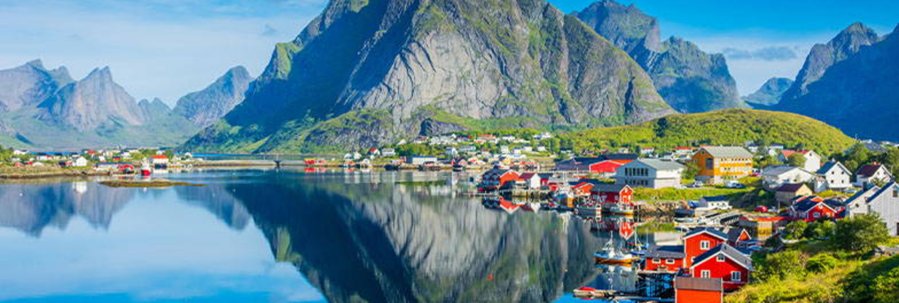

# Fjord 🌊

A native, modern Material 3 Expressive implementation of the `xdg-desktop-portal` backend for Wayland and Hyprland, built with Qt 6, C++20, and PipeWire.

[](LICENSE)
[](CMakeLists.txt)
[](CMakeLists.txt)
[](flake.nix)

Fjord (packaged and invoked as `wormhole` / `xdg-desktop-portal-wormhole`) provides a unified D-Bus portal backend and Material 3 Expressive UI dialogs for all 24 desktop portal interfaces, integrating seamlessly with PipeWire, Hyprland IPC, Caelestia shell styling, and Atlas file navigation.

> [!TIP]
> **Documentation Site:** Complete architecture deep-dives, portal interface specifications, and configuration guides are available at the **[Fjord Documentation Site](https://spanishsyntax.github.io/Fjord)**.

---

## Why "Fjord" & "Wormhole"? (The Lore)

> **fjord** (`/fjɔːd/`) — *noun:* A deep, narrow inlet of the sea flanked by steep glacial cliffs, carved by ancient glaciers to form a sheltered waterway connecting the frozen interior with the open ocean.

In polar geography, a fjord serves as the solitary navigable corridor through towering barriers of ice and stone. Without it, the frozen hinterland remains impenetrable and quarantined from the sea.

**Fjord connects isolated application sandboxes with the desktop session:**
- **Glacial Conduit**: In Wayland, modern application sandboxes (Flatpak, Snap, browser containers) are isolated by default. Fjord serves as the secure, expressive conduit between these isolated application sandboxes and the underlying desktop session.
- **Seamless Crossing**: Translates all 24 XDG Desktop Portal interfaces (ScreenCast, FileChooser, Screenshot, ColorPicker, Permissions, DynamicLauncher, Wallpaper) into unified Material 3 Expressive dialogs powered by PipeWire and Hyprland IPC, bridging sandboxed requests to user intent without friction.

---

## Showcase

| ScreenCast Chooser | Wallpaper Preview |
| :---: | :---: |
|  |  |

| Application Chooser | Permission Access Prompt |
| :---: | :---: |
|  |  |

| User Account Modal | Dynamic Launcher |
| :---: | :---: |
|  |  |

---

## Features

- **ScreenCast & Window Sharing (`org.freedesktop.impl.portal.ScreenCast`)**:
  - Material 3 Expressive dialog for sharing displays or individual application windows.
  - Hyprland IPC integration for live monitor and window discovery with application icons and workspace tags.
  - PipeWire stream node generation with hardware-accelerated / Wayland screencopy capture (`ext-image-copy-capture-v1`).
  - Persistent restore token support (`RestoreStore`) and cursor visibility modes (hidden, embedded, metadata).
- **Screenshot & Precision Color Picker (`org.freedesktop.impl.portal.Screenshot`)**:
  - Interactive region crop selector with live dimensions, magnifier loupe, and pixel grid.
  - Window and fullscreen snapshot modes.
  - Precision pixel color picker tool (`PickColor`) with instant hex/RGB clipboard export.
- **Material 3 FileChooser (`org.freedesktop.impl.portal.FileChooser`)**:
  - Native Material 3 dialog for opening files, saving files, directory selection, and multi-file selection.
  - Seamless grid and list view toggles with sorting and inline search.
  - Places sidebar, recent files tracking, bookmarks, and drive management.
- **Application Chooser (`org.freedesktop.impl.portal.AppChooser`)**:
  - Searchable Material 3 app chooser filtering system desktop entries by MIME type or URL protocol scheme.
- **Access & Permissions (`org.freedesktop.impl.portal.Access`)**:
  - Material 3 security permission prompt with dynamic `SmartIcon` mapping for microphone, camera, and device permissions.
- **Dynamic Launcher (`org.freedesktop.impl.portal.DynamicLauncher`)**:
  - Web application and desktop shortcut installer with custom icons and launch commands.
- **Wallpaper Preview (`org.freedesktop.impl.portal.Wallpaper`)**:
  - Wallpaper preview and target selection (background, lockscreen, or both) with Caelestia integration.
- **Complete 24 Portal Suite Coverage**:
  - Implements `ScreenCast`, `Screenshot`, `FileChooser`, `AppChooser`, `Access`, `Account`, `Background`, `Camera`, `Clipboard`, `DynamicLauncher`, `Email`, `GlobalShortcuts`, `Inhibit`, `InputCapture`, `Location`, `Lockdown`, `Notification`, `Print`, `Realtime`, `RemoteDesktop`, `Secret`, `Settings`, `Usb`, and `Wallpaper`.

---

## Installation

### Nix Flake & Home Manager

Add Fjord to your flake inputs:

```nix
{
  inputs = {
    nixpkgs.url = "github:nixos/nixpkgs/nixos-unstable";
    fjord.url = "github:SpanishSyntax/Fjord";
  };

  outputs = { self, nixpkgs, fjord, ... }: {
    # System or Home Manager configuration
  };
}
```

Enable Fjord in your Home Manager configuration:

```nix
{
  # In your home-manager configuration:
  programs.fjord.enable = true;
  # (alias programs.wormhole.enable is also supported)
}
```

Or add the package directly in NixOS:

```nix
environment.systemPackages = [
  inputs.fjord.packages.${pkgs.system}.default
];
```

### Manual Compilation from Source

#### Requirements
- **C++20** compiler (`gcc` 11+ or `clang` 14+)
- **CMake** ≥ 3.19
- **Ninja**
- **Qt 6.5+** (`Core`, `Gui`, `Qml`, `Quick`, `QuickControls2`, `QuickEffects`, `Concurrent`, `Svg`, `DBus`, `Network`, `Multimedia`, `Test`)
- **PipeWire** (`libpipewire-0.3`)
- **GLib / Gio 2.0**
- **Wayland Client** (`wayland-client`)
- **Wayland Protocols** (`wayland-protocols` ≥ 1.38) and `wayland-scanner`

Screen capture requires compositors implementing `ext-image-copy-capture-v1` and `ext-image-capture-source-v1` (supported in Hyprland ≥ 0.47, Sway ≥ 1.11). Window capture additionally utilizes `ext-foreign-toplevel-list-v1`.

```bash
cmake -B build -S . -GNinja -DCMAKE_BUILD_TYPE=Release -DCMAKE_INSTALL_PREFIX=/usr
cmake --build build -j$(nproc)
sudo cmake --install build
```

---

## D-Bus Portal Configuration

`xdg-desktop-portal` routes portal requests according to `portals.conf` files. To configure Fjord (`wormhole`) as the primary portal backend for Hyprland or Wayland sessions:

Create or edit `~/.config/xdg-desktop-portal/portals.conf`:

```ini
[preferred]
default=wormhole
```

Or configure interface-specific delegation (e.g. keeping Hyprland for screencopy but Fjord for all UI dialogs):

```ini
[preferred]
default=wormhole
org.freedesktop.impl.portal.ScreenCast=wormhole
org.freedesktop.impl.portal.FileChooser=wormhole
org.freedesktop.impl.portal.Screenshot=wormhole
```

Restart the portal services:

```bash
systemctl --user restart xdg-desktop-portal-wormhole.service
systemctl --user restart xdg-desktop-portal.service
```

---

## CLI & Testing Triggers

Fjord includes CLI switches to directly invoke and inspect any dialog interface without triggering third-party portal clients:

```bash
# Run backend as a resident D-Bus daemon
wormhole --daemon

# ScreenCast source chooser
wormhole --screencast --app-id "org.mozilla.firefox" --types 3 --multiple

# Interactive region crop screenshot
wormhole --screenshot --interactive

# Precision pixel color picker
wormhole --pick-color

# Embedded File Chooser (open mode)
wormhole --file-chooser --title "Select Document"

# Embedded File Chooser (save mode in directory)
wormhole --file-chooser --save --directory ~/Documents

# Application Chooser by MIME type
wormhole --appchooser --mime "image/png"

# Security permission prompt
wormhole --access --title "Camera Permission" --app-id "org.mozilla.Firefox" --icon "camera-web"

# Dynamic launcher installer
wormhole --dynamic-launcher --name "GitHub" --url "https://github.com"

# Wallpaper preview modal
wormhole --wallpaper --url "file:///usr/share/backgrounds/default.png"
```

---

## License

This project is licensed under the GNU General Public License v3.0 (GPLv3).
See [LICENSE](LICENSE) for details.
