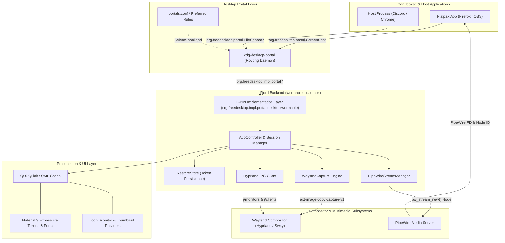

# Architecture & Design

This document details the internal design and system architecture of **Fjord** (`wormhole`), exploring how it mediates sandboxed D-Bus requests, captures Wayland surfaces, multiplexes PipeWire streams, and renders modern Material 3 Expressive dialogs.

---

## System Architecture

The following diagram illustrates how Fjord interfaces between sandboxed application runtimes, the system session bus, the Wayland compositor, and PipeWire multimedia pipelines:



---

## Why "Fjord" & "Wormhole"? (The Lore)

> **fjord** (`/fjɔːd/`) — *noun:* A deep, narrow inlet of the sea flanked by steep glacial cliffs, carved by ancient glaciers to form a sheltered waterway connecting the frozen interior with the open ocean.

In polar geography, a fjord serves as the solitary navigable corridor through towering barriers of ice and stone. Without it, the frozen hinterland remains impenetrable and quarantined from the open sea.

### The Problem of the Sandbox

Modern Wayland desktops enforce strong security boundaries. Sandboxed applications running in Flatpak, Snap, or browser containers cannot inspect other windows, read arbitrary filesystem paths, or capture display buffers directly. While essential for security, this creates an impenetrable barrier between applications and the desktop session.

### The Conduit

**Fjord** acts as this vital glacial waterway:
- **Glacial Conduit**: It forms the authorized, secure passage cutting cleanly through sandbox isolation boundaries.
- **Wormhole**: The binary name `wormhole` reflects the spatial shortcut it creates—teleporting display frames, cryptographic secrets, files, and permissions directly between isolated application containers and the user's compositor without compromising security boundaries.

---

## XDG Desktop Portal D-Bus Lifecycle

Fjord adheres strictly to the Freedesktop.org XDG Desktop Portal specification, implementing both synchronous settings queries and asynchronous multi-step dialog requests.

### Registration & Well-Known Name

When launched via `wormhole --daemon` or activated on-demand by systemd, the daemon connects to the D-Bus session bus and claims:
- **Bus Name**: `org.freedesktop.impl.portal.desktop.wormhole`
- **Object Path**: `/org/freedesktop/portal/desktop`
- **Interface Base**: `org.freedesktop.impl.portal.*`

### Request & Handle Flow

Dialog interactions (e.g. `ScreenCast`, `FileChooser`, `Screenshot`, `Access`) are asynchronous and follow the portal Request pattern:

1. **Invocation**: The caller invokes a method on `org.freedesktop.portal.Desktop`. The frontend creates a `Request` handle and passes it to Fjord's backend method:
   ```
   CreateSession(object_path handle, object_path session_handle, string app_id, dict options)
   ```
2. **Handle Allocation**: Fjord instantiates a `wormhole::portal::Request` tracker bound to the handle path:
   ```
   /org/freedesktop/portal/desktop/request/{SENDER_ESCAPED}/{TOKEN}
   ```
3. **User Presentation**: `AppController` triggers the appropriate QML dialog state on the main graphical thread.
4. **Response Emission**: Once the user accepts or dismisses the dialog, Fjord emits the standard D-Bus `Response` signal on the request object:
   ```
   Response(uint32 response_code, dict results)
   ```
   - `0`: Success (results contain selected streams, URIs, or tokens).
   - `1`: User cancellation (dialog dismissed).
   - `2`: Other failure / internal error.
5. **Automatic Teardown**: Upon response emission or caller disconnection, the request object unregisters itself from D-Bus.

### Session Persistence & Restore Tokens

ScreenCast and RemoteDesktop requests often require restoring previous session permissions (e.g., remembering which monitor a browser tab was capturing):
- Fjord persists session selections using `RestoreStore`, serializing token mappings to `~/.config/caelestia/wormhole/restore_store.json`.
- Tokens are hashed with SHA-256 against calling `app_id` and unique session secrets, preventing unauthorized token reuse.

---

## Wayland Protocols & Code Generation

Fjord bypasses legacy, lossy X11 capture methods by interfacing directly with modern Wayland staging protocols.

### Protocol Generation with `wayland-scanner`

At build time, CMake scans protocol definitions and invokes `wayland-scanner` to generate type-safe C bindings:

```cmake
find_package(PkgConfig REQUIRED)
pkg_get_variable(WAYLAND_PROTOCOLS_DIR wayland-protocols pkgdatadir)
pkg_get_variable(WAYLAND_SCANNER wayland-scanner wayland_scanner)

set(WAYLAND_PROTOCOL_XML
    "${WAYLAND_PROTOCOLS_DIR}/staging/ext-image-capture-source/ext-image-capture-source-v1.xml"
    "${WAYLAND_PROTOCOLS_DIR}/staging/ext-image-copy-capture/ext-image-copy-capture-v1.xml"
    "${WAYLAND_PROTOCOLS_DIR}/staging/ext-foreign-toplevel-list-v1.xml"
)
```

For each protocol, `wayland-scanner` emits:
- `*-client-protocol.h`: Client interface structures, event listeners, and request inline functions.
- `*-protocol.c`: Protocol marshaling tables and signature descriptors.

### Zero-Copy Capture Pipeline

The capture engine in `src/screencast/waylandcapture.cpp` operates as follows:
1. Queries display sources via `ext_image_capture_source_manager_v1`.
2. Creates an image copy capture session via `ext_image_copy_capture_manager_v1`.
3. Binds memory buffers using DMA-BUF or shared memory (`wl_shm`).
4. Receives compositor frame ready callbacks (`ext_image_copy_capture_frame_v1_ready`).
5. Directly hands buffer pointers to the active PipeWire stream.

---

## PipeWire Stream Node Architecture

Fjord streams captured video frames to sandboxed applications through PipeWire.

### Stream Negotiation Lifecycle

```
[Fjord: PipeWireStreamManager]
       │
       ├─► 1. pw_init() & pw_context_new()
       ├─► 2. pw_core_connect() to PipeWire daemon
       ├─► 3. pw_stream_new("wormhole-screencast", PW_DIRECTION_OUTPUT)
       │
[Format Negotiation]
       ├─► 4. Announce SPA_MEDIA_TYPE_video / SPA_MEDIA_SUBTYPE_raw
       ├─► 5. Propose formats: SPA_VIDEO_FORMAT_BGRx, SPA_VIDEO_FORMAT_RGBx, SPA_VIDEO_FORMAT_RGBA
       │
[Buffer Delivery]
       ├─► 6. Obtain PipeWire node ID (pw_stream_get_node_id)
       ├─► 7. Return node ID to client over D-Bus
       └─► 8. Push frames into PipeWire ring buffer on each Wayland frame ready
```

Applications (such as WebRTC in Firefox or Chromium) receive the PipeWire node ID and connect directly to the multimedia stream, offloading rendering and encoding to the GPU.

---

## Hyprland IPC Client Discovery

For window sharing (`ScreenCast` in window mode), Fjord queries the compositor to present rich window metadata, titles, and icons.

### IPC Sockets

Fjord locates the active Hyprland session via environment variables:
```
$XDG_RUNTIME_DIR/hypr/$HYPRLAND_INSTANCE_SIGNATURE/.socket.sock
```

### JSON Query Engine

`src/screencast/hyprlandipc.cpp` sends synchronous commands:
- **`j/monitors`**: Resolves monitor display geometry, refresh rates, active workspace IDs, and scale factors.
- **`j/clients`**: Returns an array of active client windows:
  ```json
  {
    "address": "0x55d78a9c40",
    "title": "Terminal — fish",
    "class": "foot",
    "workspace": { "id": 1, "name": "1" },
    "size": [960, 1080],
    "at": [0, 0]
  }
  ```

### Icon & Asset Resolution

`IconImageProvider` extracts the window's `class` attribute (e.g. `org.mozilla.firefox`) and traverses the standard XDG icon hierarchy (`~/.local/share/icons`, `/usr/share/icons`), resolving scalable SVGs or high-DPI PNGs to render beside each window choice in the chooser UI.

---

## Material 3 Expressive QML Engine

Fjord’s user interface is built with **Qt 6 Quick** using custom Material 3 Expressive components designed to harmonize with the Frost and AstraSuite design language.

### Core Controllers & QML Context

Fjord registers native C++ singletons into the QML root context:
- `AppController`: Controls modal visibility, dialog mode transitions, and user response submission.
- `ColoursSingleton`: Dynamic color scheme management supporting Caelestia color tokens.
- `TokensSingleton`: Dimension tokens, corner radii, elevation levels, and typography scales.
- `FileUtils`: Asynchronous filesystem operations, MIME type probing, and path manipulation.
- `DriveManager`: Discovers mounted storage volumes, removable drives, and mount points.

### Custom Image Providers

To keep image decoding off the main thread:
- `image://icon/`: Fast Freedesktop icon theme lookups.
- `image://monitor/`: Real-time scaled monitor frame previews.
- `image://thumb/`: Multi-threaded thumbnail generator for the File Chooser.

### Typography & Fluid Motion

- **Typography**: Embeds `GoogleSansFlex.ttf` for dynamic font weight interpolation and `MaterialSymbolsRounded.ttf` for pixel-aligned interface glyphs.
- **Spring Animations**: Dialog popups, grid transitions, and selection highlights use custom physics curves (`AnchorAnim`, `CAnim`) to achieve fluid, expressive feedback without jank.
